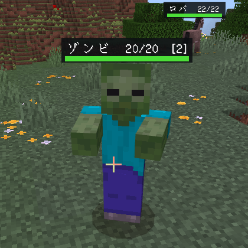

# Neat for LeviMC

[English](README.md)



[VazkiiMods の Neat](https://github.com/VazkiiMods/Neat) を参考にした、Minecraft Bedrock 用のクライアント MOD です。モブの頭上にゲーム内の名前、現在／最大 HP、体力に応じて緑から黄・赤に変わるバーを表示します。防具値がある場合は名前の右側に数値を表示します。

## 導入

Windows x64 の Minecraft Bedrock **1.26.60.5** と **LeviLamina Client 26.60.9** 向けです。[LeviLauncher で導入](levilauncher://install/github.com/sh-ayu/Neat?version=0.1.3)できます。手動で導入する場合は、[Releases](https://github.com/sh-ayu/Neat/releases) から `Neat-client-windows-x64.zip` を取得し、展開した `Neat` フォルダーをインスタンスの `mods` に入れます。

モブを 24 ブロック以内に捉えると表示します。ブロックによる遮蔽をクライアントの tick ごとに判定します。透明化したモブ、画面外のモブ、メニュー中、F1 で HUD を隠したときは表示を抑えます。混雑時は近くのラベルを優先し、同時に最大 24 個表示します。マルチプレイの HP 表示はクライアントが受け取る値に従います。

## 設定

防具立て、NPC、サーバーの案内表示に使われる一部のエンティティは表示対象から除外します。サーバー側で名前付きのモブの AI を無効にしている場合も除外されます。

初回起動時に LeviLamina の Neat 用設定ディレクトリに `config.json` を生成します。変更は MOD の再読み込みかゲーム再起動で反映されます。

```json
{
  "enabled": true,
  "maxDistance": 24,
  "showPlayers": false,
  "showArmor": true
}
```

- `maxDistance` は 4〜48 ブロックに収まるよう補正します。
- `showPlayers` は参加者一覧にいる他プレイヤーの表示を有効にします。自分とスニーク中のプレイヤーは対象外です。有効な HP を取得できない場合は `HP ?` と表示します。
- `showArmor` は防具値の表示を切り替えます。

バニラのモブ名は Minecraft の言語設定に従い、英語と日本語で表示できます。カスタム名やプレイヤー名には、ゲームやサーバーから受け取った名前を使います。

## ビルド

xmake 3.x と clang-cl を用意して、Neat ディレクトリから実行します。標準の設定では LeviLamina 26.60.8 のクライアントパッケージを使います。

```powershell
xmake f -m release -y
xmake build -y
```

配布版のビルドには LeviLamina 26.60.8 のヘッダー、Bedrock クライアントデータ `26.60.5-client.16`、クライアント用のインポートライブラリを使いました。ローカル SDK を使う場合はソースと `LeviLamina.lib` のディレクトリを指定します。

```powershell
xmake f -m release -y --ll_src="C:/path/to/LeviLamina" --ll_libdir="C:/path/to/sdk"
xmake build -y
```

成果物は `bin/Neat/` に出力されます。

## ライセンス

実装のライセンスは [MIT](LICENSE) です。Java Edition 版の開発者に感謝します。[オリジナルの Neat](https://github.com/VazkiiMods/Neat) · [依存ライブラリのライセンス](THIRD_PARTY_NOTICES.md)
