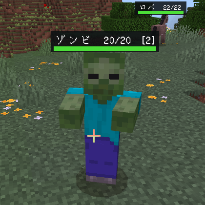

# Neat for LeviMC

[日本語](README.ja.md)



Neat adds overhead health bars to Minecraft Bedrock. Each label shows the mob's name, current and maximum HP, and armor value when it has armor. The bar changes from green through yellow to red as health drops.

## Compatibility and installation

This release targets Minecraft Bedrock for Windows x64 **1.26.60.5** with **LeviLamina Client 26.60.9**.

In LeviLauncher, use [Install Neat](levilauncher://install/github.com/sh-ayu/Neat?version=0.1.3). For a manual install, download `Neat-client-windows-x64.zip` from [Releases](https://github.com/sh-ayu/Neat/releases), extract the `Neat` folder into your instance's `mods` folder, and start the game.

## Behavior and settings

Neat shows up to 24 nearby labels. Blocks that obscure a mob, invisibility, and a hidden HUD suppress the label. Armor stands, NPCs, and common lobby display entities are filtered out.

Neat creates `mods/Neat/config/config.json` when first enabled. Restart the game to apply changes.

| Key | Default | Description |
| --- | --- | --- |
| `enabled` | `true` | Show Neat labels. |
| `maxDistance` | `24` | Maximum distance in blocks, clamped to 4–48. |
| `showPlayers` | `false` | Show other nearby players from the session roster. Sneaking players are hidden. |
| `showArmor` | `true` | Show an armor value when available. |

Vanilla mob names follow the game language, including English and Japanese. Custom names and player names use the text supplied by the game or server. Player HP depends on client-side data. When a valid HP value is unavailable, Neat shows `HP ?` with an empty track.

## Build

Use xmake 3.x and clang-cl from a Windows x64 development environment.

```powershell
xmake f -m release -y
xmake build -y
```

The mod is staged in `bin/Neat/`. The release was built with [LeviLamina 26.60.8 headers](https://github.com/LiteLDev/LeviLamina/tree/v26.60.8), Bedrock client data `26.60.5-client.16`, and a client import library. To use that build route with your own client import library, pass both paths explicitly.

```powershell
xmake f -m release -y --ll_src="C:/path/to/LeviLamina" --ll_libdir="C:/path/to/sdk"
xmake build -y
```

## Credits and license

Inspired by [Neat for Java Edition](https://github.com/VazkiiMods/Neat) by Vazkii, Violet Moon, and contributors. This Windows client implementation is available under the [MIT License](LICENSE). See [third-party notices](THIRD_PARTY_NOTICES.md) for linked components.
